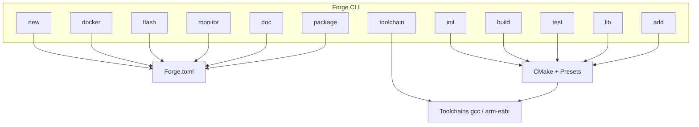
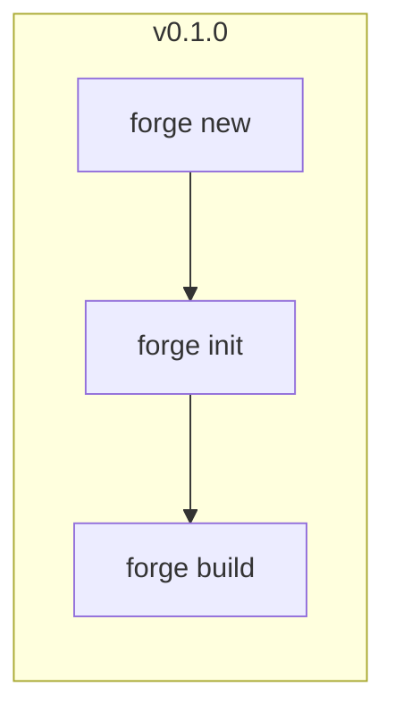
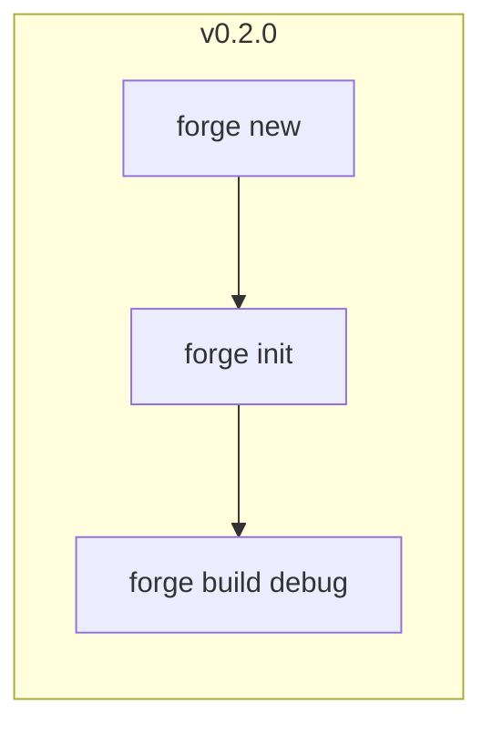

# Forge Development Roadmap

Forge is a Go CLI for embedded C/C++ projects built on **CMake**, **CMake presets**, and cross-compilation toolchains. **v0.2.0** (STM32 project bootstrap) is delivered. Development continues through incremental releases to **v1.0.0**.

## Vision

**Phase 1 (v0.2.0–v0.6.0):** STM32 bare-metal and host builds on Windows and Linux development hosts.

**v1.0.0:** Stable release supporting host Windows and Linux and STM32 cross-build — with `forge toolchain`, Docker, CMake library targets, and the full v1 command set.

**v2.0.0 (future):** Embedded Linux targets (Raspberry Pi, `gcc-arm-linux-gnueabihf`).

## v1.0.0 target

| Area | Requirement |
|------|-------------|
| **Targets** | Host Windows and Linux (`gcc`), STM32 bare-metal (`gcc-arm-none-eabi`) |
| **Build base** | CMake + CMakePresets + CMake library targets |
| **Reproducibility** | Docker dev environment generation |
| **Commands** | `new`, `init`, `toolchain`, `docker`, `build`, `doc`, `flash`, `monitor`, `test`, `lib`, `add`, `package` |

Example end-state workflow:

```bash
forge new blink stm32f103r8
cd blink
forge init
forge toolchain install all   # download tools from tools.yaml into the user cache
forge toolchain check         # report installed versions
forge build debug
forge flash
forge monitor
```

## Architecture

`Forge.toml` is the single source of truth for project configuration. Project commands read or update it; CMake files are generated from it. `forge toolchain` is the exception: it reads `internal/toolchain/tools.yaml` and does not read or write `Forge.toml`.



### Planned internal packages

| Package | Purpose |
|---------|---------|
| `internal/config/` | Load, save, and validate `Forge.toml` |
| `internal/devices/` | STM32 board catalog (starting with `stm32f103r8`) |
| `internal/toolchain/` | Embedded `tools.yaml` catalog; download and extract toolchain binaries into the user cache |
| `internal/templates/` | Target-aware project templates (evolved from `contents/`) |
| `internal/package/` | Download and extract third-party archives (CMSIS) into the user cache |
| `cmd/<command>.go` | One file per CLI command |

## Forge.toml schema

Schema grows across releases. Target shape at v1.0.0:

```toml
[project]
name = "blink"
version = "0.1.0"

[target]
kind = "stm32"          # host | stm32  (arm-linux deferred to v2.0.0)
board = "stm32f103r8"   # device catalog key

[toolchain]
compiler = "gcc-arm-none-eabi"

[tools]
openocd = "0.12.0"
stflash = "1.7.0"

[flash]
interface = "stlink"
transport = "swd"

[monitor]
port = "/dev/ttyUSB0"
baud = "115200"

[dependencies]
# v1 target shape (table). v0.2.0 writes a top-level array instead:
# dependencies = ["cmsis5@5.9.0", "stm32f1-cmsis-device@4.3.5", "stm32f1-hal@1.1.10"]
```

CMake and the other relocatable tools are not versioned in `Forge.toml`. `internal/toolchain/tools.yaml` pins the version and the Windows and Linux download URLs. `forge toolchain` reads that file and does not read or write `Forge.toml`. `cmake_minimum_required` in generated projects stays `3.20`.

## forge toolchain behavior

`forge toolchain` downloads pinned binaries into the user cache and reports what is installed.


| | |
|---|---|
| **Input** | `internal/toolchain/tools.yaml` (name, version, per-OS URL). Not `Forge.toml`. |
| **Output** | Archives extracted under the user cache. Nothing written back to `Forge.toml`. |
| **Hosts** | Windows and Linux. macOS is out of scope. |
| **Flags** | `--dry-run` |

Install root (`os.UserCacheDir()`):

- Windows: `%LOCALAPPDATA%\forge\toolchains\<name>\<version>\`
- Linux: `~/.cache/forge/toolchains\<name>\<version>\`

| Command | Role |
|---------|------|
| `forge toolchain install <name>` | Download one catalog tool (`cmake`, `ninja`, `gcc-arm-none-eabi`, `openocd`) |
| `forge toolchain install all` | Download every tool in the catalog |
| `forge toolchain check` | Compare the cache, then `PATH`, with the YAML version |

## Command delivery matrix

| Command | Introduced |
|---------|-----------|
| `forge new` | v0.1.0 (enhanced v0.2.0) |
| `forge init` | v0.1.0 (enhanced v0.2.0) |
| `forge build` | v0.1.0 (enhanced v0.3.0) |
| `forge toolchain` | v0.3.0 |
| `forge flash` | v0.4.0 |
| `forge monitor` | v0.4.0 |
| `forge lib` | v0.5.0 |
| `forge add` | v0.5.0 |
| `forge docker` | v0.6.0 |
| `forge test` | v0.6.0 |
| `forge doc` | v1.0.0 |
| `forge package` | v1.0.0 |

---

## v0.1.0 — Prototype (delivered)

Basic CLI skeleton and generic project scaffolding.

1. **`forge new <name>`** — create project directory and generic `Forge.toml`
2. **`forge init`** — generate starter folders and static templates (`main.c`, `CMakeLists.txt`, `CMakePresets.json`)
3. **`forge build`** — run CMake configure and build in `build/`



Known limitation (fixed in v0.2.0): `forge init` used in-memory config and did not read `Forge.toml` from disk.

---

## v0.2.0 — STM32 project bootstrap (delivered, current)

**Phase 1 start.** Device-aware project creation for STM32.

1. **`forge new <name> <device>`** — device-aware `Forge.toml` (first board: `stm32f103r8`; e.g. `forge new blink stm32f103r8`)
2. **`forge init`** — read `Forge.toml` from cwd; generate STM32 project tree (linker + CMake; GCC `startup_*.s` and `system_*.c` copied from CMSIS-Device); fetch remaining `dependencies` into `~/.cache/forge/packages/` and emit `cmake/Package.cmake` (CMSIS INTERFACE, family HAL STATIC)
3. **gcc-arm-none-eabi + CMake preset** — toolchain file and `CMakePresets.json` entries `debug` / `release` (CPU/FloatABI/`STM32_DEVICE` from the device catalog; `FLASH_KB`/`RAM_KB` on the preset; flash/RAM in `LinkerScript.ld`; `forge build debug`)

Does **not** install host tools. CMake and `gcc-arm-none-eabi` must already be on `PATH`. Downloading them from `internal/toolchain/tools.yaml` via `forge toolchain` is v0.3.0.



Next: [v0.3.0](#v030--toolchain-install-and-check-windows-and-linux).

---

## v0.3.0 — Toolchain install and check (Windows and Linux)

1. **`internal/toolchain/tools.yaml`** — embedded catalog (`cmake`, `ninja`, `gcc-arm-none-eabi`, `openocd`) with version, sha256, and per-OS URL. `{version}` is substituted the same way as package URLs. `install all` means every key in the file. Host `gcc` is not an entry.
2. **`forge toolchain install <name|all>`** — download and extract into `%LOCALAPPDATA%\forge\toolchains\` on Windows and `~/.cache/forge/toolchains/` on Linux. Skip a version that is already present. `--dry-run` prints the URL and destination. Does not read or write `Forge.toml`, call apt, or change the system `PATH`.
3. **`forge toolchain check`** — probe the cache, then `PATH`; run `--version`; report `ok`, `missing`, or `version mismatch`. Non-zero exit when a catalog tool is missing.
4. **Build uses the cache** — host preset on Windows and Linux; `forge build` prepends the cache `bin` directory for the child process; keep a host/generic `new` / `init` path for non-STM32 projects.

---

## v0.4.0 — STM32 on-device workflow

1. **`forge flash`** — flash `.elf`/`.bin` via OpenOCD (ST-Link) with `st-flash` fallback
2. **`forge monitor`** — attach to serial port and stream logs (port/baud from `Forge.toml`)
3. **Flash/monitor defaults per board** — ST-Link + USART defaults for `stm32f103r8` in device catalog

---

## v0.5.0 — Libraries and third-party code

1. **`forge lib <name>`** — scaffold static/shared library (`lib/<name>/CMakeLists.txt`, `include/`, `src/`)
2. **`forge add <package>`** — CLI to add further third-party sources (FreeRTOS); CMSIS Core and family HAL are already fetched on `init` from `dependencies`
3. **CMake library targets** — wire `forge lib` output into root build graph

---

## v0.6.0 — Reproducible builds and testing

1. **`forge docker`** — generate `Dockerfile` and optional `docker-compose.yml` pinned to tool versions from `Forge.toml`
2. **`forge test`** — create `tests/` layout; fetch test framework (Unity + CMock via CMake `FetchContent`)
3. **Complete CMake presets matrix** — unified presets for host/stm32 debug and release

---

## v1.0.0 — First stable release

1. **`forge doc`** — generate Doxygen config and `docs/` scaffold from `Forge.toml` and project sources
2. **`forge package`** — produce Linux host distributable (`.tar.gz` or `.deb`) with requirements manifest
3. **Release polish** — reference example (`blink` on STM32F103R8), updated README, integration smoke tests for all v1 commands

### v1.0.0 checklist

- [ ] Toolchains: `gcc`, `gcc-arm-none-eabi`
- [ ] Infrastructure: Docker, CMake libs, CMake presets, `forge toolchain`
- [ ] Targets: host Windows and Linux, STM32
- [ ] Commands: `new`, `init`, `toolchain`, `docker`, `build`, `doc`, `flash`, `monitor`, `test`, `lib`, `add`, `package`

---

## v2.0.0 — Embedded Linux (future)

Cross-compilation for ARM Linux targets. Deferred from v1.0.0.

1. **gcc-arm-linux-gnueabihf toolchain module** — CMake toolchain file for cross-compiling to ARM Linux
2. **Raspberry Pi target preset** — `target.kind = "arm-linux"`, board profile (e.g. `raspberry-pi-4`)
3. **`forge build` cross-compile path** — build Linux ARM binaries on the host using the toolchain cache

---

## Out of scope for v1.0.0

- Embedded Linux / Raspberry Pi (planned v2.0.0)
- macOS host support
- Full STM32 family catalog (F1 / F7 / G4 starter set; expand further post-1.0)
- IDE plugins (VS Code extension)
- Cloud CI templates

These constraints keep v1.0.0 focused on **Windows and Linux hosts + STM32**.
